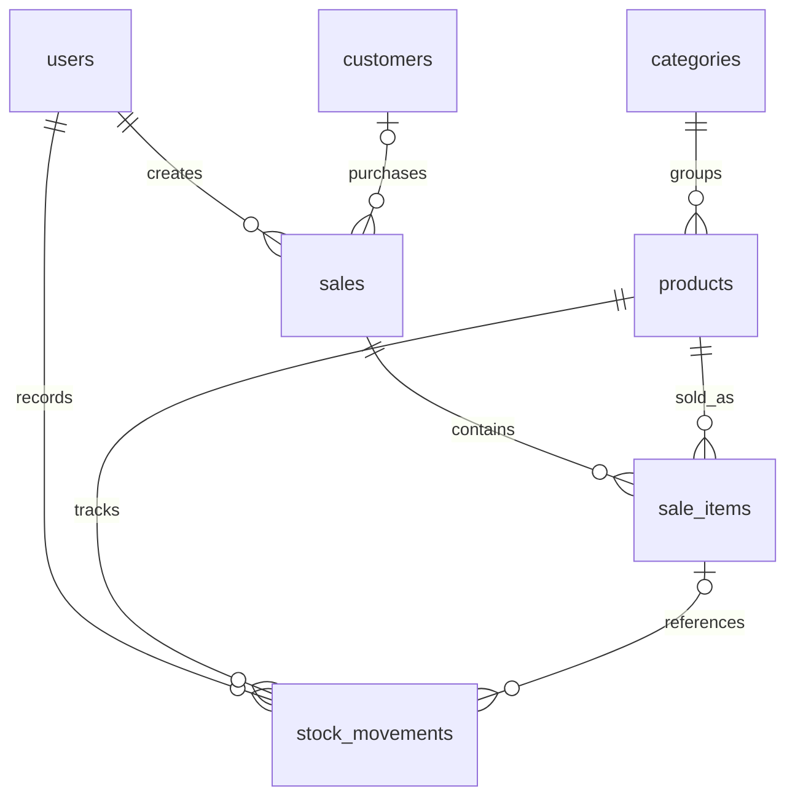

# Krivent API — Phase 3

Fondasi backend Inventory & Sales Management untuk distributor elektronik fiktif.
Modular monolith: controller menangani HTTP, service menangani logika, Prisma mengakses PostgreSQL.
Phase 3 menambahkan login JWT, refresh token rotation/replay protection, session revocation, Users dan RBAC.
Semua endpoint bisnis memerlukan Bearer token; health tetap public. Katalog tetap mempertahankan aturan Phase 2.
CRM, mutasi Inventory, Sales, dashboard/reporting, audit log dan frontend belum diimplementasikan.

- [Setup Admin, Postman dan checklist Phase 3](docs/phase3-postman-guide.md)
- [Audit, arsitektur autentikasi, matriks role dan mentoring](docs/phase3-authentication.md)
- [Hasil verifikasi dan seluruh file berubah](PHASE3-VERIFICATION.md)
- [Kebutuhan bisnis](docs/business-requirements.md) dan [arsitektur/ERD baseline](docs/architecture.md)

## Versi dan prasyarat

- Node.js 24 LTS (diverifikasi dengan 24.22.2), npm 11.
- NestJS 12.4.2, TypeScript 6.0.3, ESM, Vitest 4.
- Prisma CLI/client/adapter-pg **7.10.1**, dipin agar tetap seragam. Registry saat pengerjaan
  menunjuk Prisma 8 RC sebagai `latest`; jangan upgrade tanpa memeriksa status stabilnya.
- Docker Engine/Desktop aktif dan Docker Compose.
- PostgreSQL 17 dari `postgres:17-alpine`. API berjalan di host, database di container.

Node 24 sesuai [persyaratan Prisma 7](https://www.prisma.io/docs/orm/reference/system-requirements).

## Menjalankan dari awal

Jalankan perintah dari direktori `apps/api`:

```sh
npm ci
cp .env.example .env
```

Jika `.env` sudah ada, **jangan timpa**; tambahkan variabel yang belum ada.
Ganti password contoh dengan password lokal sendiri, lalu sesuaikan `DATABASE_URL`.
Password dalam URL harus di-percent-encode jika mengandung karakter khusus.
`POSTGRES_USER`, `POSTGRES_PASSWORD`, `POSTGRES_DB`, dan `POSTGRES_PORT` harus cocok dengan URL.
Saat setup Phase 1, file lokal yang sudah ada dipertahankan dan dilengkapi password acak.

```sh
docker compose up -d --wait
npm run prisma:generate
npm run db:deploy
npm run build
# Siapkan AUTH_JWT_SECRET di .env dan bootstrap Admin sesuai panduan Phase 3.
npm run start:dev
```

`db:deploy` menerapkan migrasi yang sudah disimpan tanpa membuat migrasi baru.
Untuk mengembangkan schema selanjutnya: ubah `prisma/schema.prisma`, lalu jalankan
`npm run db:migrate -- --name nama_perubahan`. Jangan memakai `db push` sebagai pengganti riwayat migrasi.

- API: http://localhost:4000/api/v1
- Health: http://localhost:4000/api/v1/health
- Swagger UI: http://localhost:4000/api/docs
- OpenAPI JSON: http://localhost:4000/api/docs-json
- Frontend yang diizinkan CORS: `http://localhost:5173` (ubah `FRONTEND_ORIGIN` jika diperlukan).

API dan port database hanya bind ke loopback untuk pengembangan lokal.
`PORT` default 4000. AUTH_JWT_SECRET wajib 64 digit hex acak (32 byte), tanpa default.
Lihat .env.example dan panduan Phase 3 untuk issuer/audience, expiry dan bootstrap Admin.
`FRONTEND_ORIGIN` harus berupa satu origin HTTP localhost/127.0.0.1
tepat tanpa path atau trailing slash. Browser memblokir origin lain karena header CORS
hanya mengizinkan origin yang dikonfigurasi. CORS bukan autentikasi atau pembatas akses curl.

Untuk menjalankan hasil kompilasi:

```sh
npm run build
npm run start:prod
```

Client Prisma dihasilkan ke `src/generated/prisma` dan dikompilasi ke `dist/generated/prisma`.
Generated client diabaikan Git; generate ulang setelah instalasi. `build` menjalankan generate otomatis.
Relative import memakai `.js`; test memakai `vi`, bukan Jest.

## Struktur

```text
prisma.config.ts                 URL database untuk CLI Prisma 7
prisma/schema.prisma            Model dan relasi
prisma/migrations/              SQL versioned, termasuk CHECK constraints
compose.yaml                    PostgreSQL, health check, named volume
src/app.module.ts               Komposisi modul dan Observe opsional
src/main.ts                     Bootstrap dan port
src/configure-app.ts            Prefix, validation pipe, CORS, Swagger, shutdown
src/config/                     Validasi environment dan unit test
src/prisma/                     Provider Prisma dan lifecycle koneksi
src/health/                     Controller HTTP dan service health
src/catalog/                    Katalog, dilindungi global auth + Roles
src/auth/                       Login/refresh/logout, JWT provider, role guard
src/users/                      DTO, Users management, safe presenter
src/security/                   Argon2id password hashing
src/common/                     Error filter API bersama
src/admin-bootstrap.ts          Command Admin awal lewat stdin
docs/                           Kebutuhan bisnis, arsitektur, checklist manual
test/                          Pengujian HTTP dan integrasi database
```

`PrismaModule` mengekspor satu provider koneksi. `HealthModule` mengimpor provider tersebut
serta `TerminusModule`. CatalogModule mengimpor PrismaModule dan memisahkan controller dari service bisnis; tanpa abstraksi repository tambahan.

## ERD



| Tabel           | Keputusan utama                                                                                   |
| --------------- | ------------------------------------------------------------------------------------------------- |
| users           | Email unik, nama, password_hash, role, status aktif; JWT dan session server-side                  |
| categories      | Nama unik, deskripsi, dan status aktif (migrasi aditif Phase 2)                                   |
| products        | SKU unik, kategori wajib, harga pokok/jual, saldo stok, status aktif                              |
| customers       | Kode unik, nama, kontak opsional; email tidak harus unik                                          |
| sales           | Invoice unik, pembuat wajib, pelanggan opsional, status DRAFT/COMPLETED/CANCELLED, total, sold_at |
| sale_items      | Satu produk per penjualan, jumlah positif, snapshot unit_price                                    |
| stock_movements | Produk/pelaksana wajib, jenis mutasi, delta jumlah bertanda, referensi sale_item opsional         |

Seluruh ID UUID dibuat Prisma. Tabel/kolom menggunakan snake_case, model TypeScript PascalCase/camelCase.
`created_at` memakai default database; `updated_at` dikelola Prisma (`@updatedAt`), bukan trigger SQL.
Penulisan langsung melalui SQL harus mengisi updated_at. Semua timestamp `timestamptz(3)`.
Uang memakai `Decimal(18,2)`, bukan float; untuk fase berikutnya gunakan Prisma.Decimal dan
kirim nilai uang sebagai string. Asumsi awal satu mata uang IDR dengan dua angka desimal;
belum ada pajak, diskon, pembayaran, atau multi-currency.

Foreign key memakai `RESTRICT` saat delete agar riwayat tetap terlindungi. Gunakan status/nonaktif
pada fase domain berikutnya. Kolom foreign key dan pencarian/report yang relevan diindeks.
Unique index `(sale_id, product_id)` sekaligus melayani pencarian berdasarkan sale_id.
Composite foreign key `(sale_item_id, product_id)` memastikan referensi mutasi selalu ke produk yang sama.
Unique constraint email, SKU, dan nama kategori tetap case-sensitive sesuai PostgreSQL.
Phase 2 menormalisasi input SKU baru menjadi uppercase, tanpa menulis ulang data lama; nama kategori di-trim.
Benturan SKU legacy lowercase perlu diaudit sebelum migrasi case-insensitive global.

CHECK constraints dalam SQL migrasi menjaga harga/total/stok >= 0, jumlah item > 0,
dan mutasi != 0. OPENING/PURCHASE/RETURN positif, SALE negatif dan wajib mereferensikan item;
ADJUSTMENT boleh positif/negatif. Semua RETURN saat ini berarti barang masuk kembali dari pelanggan.
Prisma DSL belum menyatakan CHECK constraints tersebut; pertahankan SQL-nya pada migrasi berikutnya.

`stock_quantity` adalah saldo, `stock_movements` adalah jurnal. Schema belum otomatis menyamakan
keduanya atau menghitung `total_amount`: fase penjualan harus memperbarui saldo, jurnal,
item, dan total dalam satu transaksi dengan perlindungan konkurensi. Jangan menganggap perubahan
status DRAFT menjadi COMPLETED sudah memiliki efek stok pada fase ini.

## Environment dan keamanan konfigurasi

`.env`, seluruh `.env.*` (kecuali `.env.example`), node_modules, dist, coverage, generated client,
dan tsbuildinfo diabaikan Git. `.env.example` hanya berisi placeholder.
Validasi `@nestjs/config` + Zod menghentikan startup jika URL database tidak valid,
port di luar 1–65535, origin bukan lokal, atau hanya salah satu kunci Observe tersedia.
Environment dipakai server saja, tidak diekspos melalui endpoint.

Observe yang ada dipertahankan dan diaktifkan jika kedua kunci disediakan.
Tanpa kunci, aplikasi dapat berjalan lokal tanpa telemetry. Jangan commit atau menyalin kunci
ke screenshot/log publik. Setup produksi, TLS, authentication, secret manager, dan deployment
berada di luar Phase 1.

Global `StandardSchemaValidationPipe` mengikuti API NestJS 12.
Endpoint katalog mengikat schema melalui `@Body({ schema })`,
`@Query({ schema })`, atau `@Param('id', { schema })`; gunakan `z.strictObject(...)`
untuk menolak properti asing. Pemasangan pipe saja tidak memvalidasi parameter tanpa schema.
Health tidak menerima body. Endpoint probe validasi hanya ada di test, tidak di aplikasi.

## Health dan pengujian

```sh
curl -i http://localhost:4000/api/v1/health
npm run db:status
npm run lint
npm run build
npm test
npm run test:e2e
npm run test:integration
```

Health menggunakan indikator Prisma bawaan Nest Terminus dan query `SELECT 1`, bukan respons statis.
Normal: HTTP 200 dengan `status: "ok"` dan `details.database.status: "up"`.
Database tidak dapat dijangkau: HTTP 503 dan `status: "error"`; detail koneksi disamarkan.
Timeout indikator, koneksi pool, dan query dibatasi sekitar 3 detik.
Startup mencoba menghubungkan database; jika koneksi awal gagal, aplikasi dapat gagal startup.
Untuk menguji 503, matikan database **setelah aplikasi aktif**, lalu pulihkan:

```sh
docker compose stop postgres
curl -i http://localhost:4000/api/v1/health
docker compose up -d --wait
curl -i http://localhost:4000/api/v1/health
```

Unit test memeriksa environment, role guard dan Argon2id. Tes HTTP fondasi memakai database double untuk menguji 200/503,
prefix, Swagger, CORS, dan validasi input. Tes integrasi membutuhkan PostgreSQL yang telah dimigrasi,
memakai koneksi nyata: tes fondasi memeriksa constraint dengan transaksi rollback; tes katalog/identity/bootstrap memakai schema acak terisolasi. Build dahulu karena bootstrap suite menjalankan dist/admin-bootstrap.js.
Semua suite bisa membutuhkan izin socket lokal jika dijalankan di sandbox.

```sh
curl -i -X OPTIONS http://localhost:4000/api/v1/health \
  -H 'Origin: http://localhost:5173' \
  -H 'Access-Control-Request-Method: GET'
```

Respons memiliki `Access-Control-Allow-Origin: http://localhost:5173`.
Origin lain tidak mendapat izin CORS yang cocok.

## Persistensi dan troubleshooting

`docker compose down` menghapus container/network tetapi mempertahankan named volume
`krivent_postgres_data`. **Jangan gunakan `down -v` jika data masih dibutuhkan**.
Environment POSTGRES_* hanya menginisialisasi database saat volume masih kosong;
mengubah password di .env saja tidak mengganti password database yang sudah ada.
Jika port 5432 dipakai, ganti POSTGRES_PORT dan port DATABASE_URL bersamaan.
Gunakan `docker compose ps` dan `docker compose logs postgres` untuk diagnosis.
Tidak ada perintah reset database otomatis pada setup ini.

Lihat `PHASE1-VERIFICATION.md` untuk riwayat fondasi dan `PHASE2-VERIFICATION.md` untuk verifikasi katalog.

## Authentication Phase 3

Admin mengelola Users dan seluruh Catalog; Sales read-only Catalog; Warehouse read/create/update Catalog tetapi tidak archive.
Login/refresh mengembalikan token JSON. JWT access 15 menit, refresh 7 hari dan session absolute 30 hari secara default.
Access token diperiksa dengan session/user di DB sehingga logout, password/email/role change dan deaktivasi segera berlaku.
Refresh single-use; replay, termasuk refresh concurrent, mencabut family. Klien wajib single-flight refresh.

Tidak ada public registration atau password Admin default. Jalankan npm run build lalu npm run admin:bootstrap dengan JSON stdin sesuai panduan.
Guard development lokal telah diganti authentication/RBAC; mode production tidak lagi otomatis menolak Admin yang terautentikasi,
namun aplikasi tetap bind loopback dan belum di-deploy. CORS bukan autentikasi.

Tambahan tabel: auth_sessions, refresh_tokens, admin_bootstrap; User.role default SALES_STAFF untuk data lama.
Migrasi 20261110060000_identity_sessions mempertahankan data/relasi lama dan menambah unique normalized email expression index.
API User hanya mengembalikan field allowlist, tanpa passwordHash maupun token hash. Semua response no-store.

Lihat PHASE3-VERIFICATION.md untuk hasil pemeriksaan terbaru. PHASE1/PHASE2-VERIFICATION.md merupakan riwayat fase sebelumnya.

## Phase 4 — CRM Backend

CRM mencakup lead lifecycle NEW → CONTACTED → QUALIFIED → PROPOSAL → WON/LOST,
konversi customer transaksional/idempotent, activity append-only, dan follow-up.
Admin mengelola semua data; sales hanya owner sendiri; Warehouse tidak mendapat akses CRM.
Customer lama dipertahankan dengan owner nullable, tersedia bagi Admin untuk assignment.

- [Desain, ERD, RBAC dan kontrak API](docs/phase4-crm.md)
- [Urutan request Postman](docs/phase4-postman-guide.md)
- [Hasil verifikasi aktual](PHASE4-VERIFICATION.md)

Gunakan `npm run db:deploy` untuk menerapkan migrasi yang sudah ditinjau pada database lokal.
Swagger `/api/docs` memuat route CRM dengan Bearer authentication.
