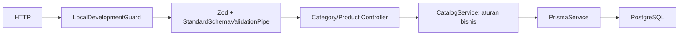
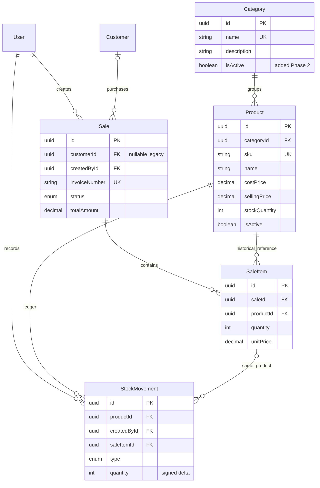
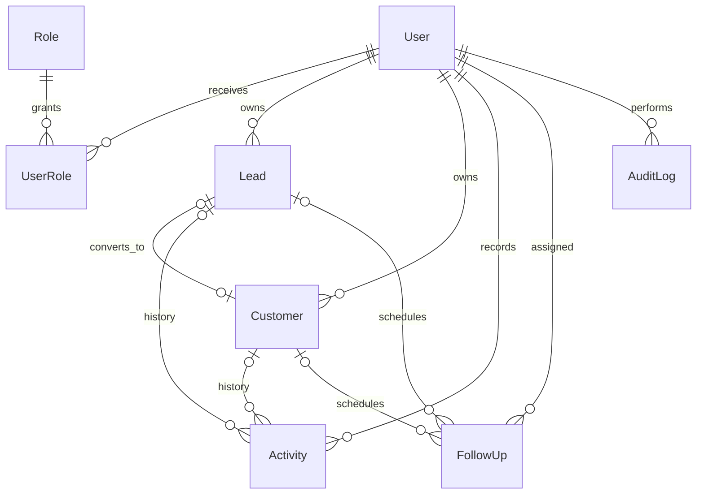

# Arsitektur dan model data Krivent

## Audit awal repository

Runtime lokal Node 24.22.2; hasil npm ls: Nest common/core 12.4.2, Swagger 12.1.1, Prisma CLI/client/adapter-pg 7.10.1, TypeScript 6.0.3, Zod 4.6.7, Vitest 4.1.12. ESM memakai import relatif .js dan explicit @Inject agar kompatibel dengan transformasi Vitest tanpa metadata constructor.

Awalnya hanya HealthModule, PrismaModule, ConfigModule dan Observe opsional. Health memakai Terminus dan query nyata. configureApp memasang prefix api/v1, StandardSchemaValidationPipe, CORS origin lokal, Swagger. main bind loopback. README dan PHASE1-VERIFICATION mendokumentasikan fondasi; test mencakup environment, HTTP health/validasi/Swagger/CORS dengan double, serta constraint PostgreSQL dengan rollback.

Migrasi awal 20261110031230_init memiliki tujuh tabel: User, Category, Product, Customer, Sale, SaleItem, StockMovement; Decimal(18,2), FK RESTRICT, index, CHECK harga/total/stok dan arah mutasi. Product memiliki isActive, Category belum. Tidak ada modul CRUD, RBAC, tabel lead/role/audit. Saldo dan jurnal belum otomatis konsisten. Tidak ada asumsi bahwa model yang sudah ada berarti workflow sudah berjalan.

Git terdeteksi berasal dari direktori induk di luar proyek; pemeriksaan status awal mencakup file lain. Pekerjaan ini hanya menyentuh apps/api dan tidak melakukan operasi staging/commit/reset.

## Modul dan alur request

CatalogModule adalah domain katalog, bukan modul generik per tabel untuk seluruh aplikasi. Controller hanya memetakan HTTP, schema, dokumentasi dan representasi; service memegang aturan aktif/arsip/relasi/transaksi. PrismaService tetap persistence layer bersama; tidak ditambah abstraksi repository yang sekadar meneruskan Prisma. Modul CRM, Inventory, Sales, Identity, Reporting dan Audit baru dibuat ketika diimplementasikan. Antar-domain kelak memanggil service publik, bukan mengubah stok lewat Catalog.

## ERD eksisting dan aditif Phase 2

SaleItem memiliki unique(saleId,productId), juga unique(id,productId) untuk composite FK StockMovement. Kolom timestamp, kontak Customer dan kredensial User tetap sesuai schema Prisma. Seluruh FK delete RESTRICT. Tidak tersedia hard-delete API.

## ERD target tambahan (belum ada migrasi/implementasi)

Lead: id, company/contact, stage, ownerId, lostReason, convertedCustomerId unique nullable. Customer.ownerId merupakan tambahan rencana. Activity dan FollowUp memiliki salah satu subject lead/customer, divalidasi XOR agar tidak menjadi relasi ambigu. AuditLog: actorId, action, entityType/entityId, timestamp dan perubahan yang sudah disensor; tidak menyimpan password/token. Role/UserRole menampung admin/sales/warehouse, permissions didefinisikan server. Perubahan target memerlukan migrasi aditif tersendiri, bukan modifikasi tabel sekarang.

## Keputusan implementasi dan alasan interview

1. **Migrasi aditif:** hanya menambah categories.is_active NOT NULL DEFAULT true. Data kategori lama tetap aktif; migrasi awal dan CHECK manual tidak diubah. Tidak memakai db push/reset. Kolom default memungkinkan deployment aplikasi baru setelah migrasi.
2. **String → Decimal → string:** Zod memvalidasi bentuk harga tanpa Number/coerce. Prisma menyimpan numeric(18,2); presenter memakai toFixed(2). Menghindari pembulatan floating point dan silent rounding pecahan berlebih. Harga katalog adalah input admin lokal; harga/total order kelak diambil/dihitung server, bukan dipercaya dari klien penjualan.
3. **Arsip:** boolean mempertahankan referensi sales/ledger dan unique SKU. Update arsip 409, detail tetap tersedia. Tidak menambahkan restore sebelum kebutuhan operasional jelas.
4. **Konkruensi:** transaksi serializable menyatukan pemeriksaan kategori aktif dan create/update produk serta pemeriksaan jumlah produk aktif dan archive kategori. Write skew ditolak PostgreSQL; P2034 di-retry maksimal dua kali setelah percobaan awal, kemudian 409. Unique constraint database menjadi otoritas konflik SKU, bukan precheck rentan race. Operasi katalog tidak pernah menulis saldo/jurnal.
5. **List:** filter/sort/pagination di PostgreSQL, whitelist field, pageSize <=100 dan offset dibatasi. Count/data dalam transaksi RepeatableRead melihat snapshot yang sama. Offset cocok skala MVP; halaman antar-request dapat bergeser jika data berubah. ILIKE substring belum optimal dengan B-tree; pertimbangkan index trigram/cursor hanya setelah pengukuran, tanpa menambahkan infrastruktur sekarang.
6. **Validasi:** schema Zod yang sudah terpasang, strictObject menolak mass assignment. Partial update tidak boleh kosong. UUID invalid 400, kategori tidak ada 404, kategori arsip/duplikat 409. Nullable description dapat dikosongkan dengan null. SKU uppercase hanya untuk input baru, bukan migrasi data lama.
7. **Respons:** detail/mutasi `{data: ...}`, list `{data: [...], meta: {page,pageSize,total,totalPages}}`. Filter khusus katalog menyeragamkan `{statusCode,message}` untuk validation/HTTP/Prisma tanpa membocorkan query/credentials. Pesan validasi dapat berupa daftar issue schema. Error tidak dikenal 500 generik; konflik FK 409. Kontrak health Terminus dipertahankan. Route yang tidak tersedia tetap memakai default Nest 404 (termasuk field error bawaan), di luar filter controller katalog.
8. **Keamanan sementara:** guard memerlukan development dan peer socket loopback. Tidak menggunakan header proxy sebagai bukti. Ini secara eksplisit hanya lokal; auth/RBAC masih fase berikutnya, bukan role palsu di header. Bootstrap binding loopback dipertahankan. Proxy/tunnel lokal tidak termasuk lingkungan yang diizinkan.
9. **Swagger:** request/response schemas, examples, query allowlist dan status error didokumentasikan melalui decorator bersama. Dokumentasi raw schema tidak memerlukan DTO class/class-validator tambahan; test memeriksa kontrak penting agar schema dokumentasi tidak bergeser.

## Pengujian dan operasional

Lihat phase2-manual-testing.md untuk contoh curl yang dapat diimpor Postman. Unit test memeriksa batas harga/guard; HTTP database integration menguji service, validasi, error, concurrency, arsip dan persistensi melalui koneksi independen. Fixture memakai UUID dan dibersihkan hanya berdasarkan kategori milik suite; test lama memakai rollback. Jangan menjalankan test pada database produksi.

Gunakan npm run db:deploy untuk migrasi tersimpan; npm run db:status untuk status. Jalankan lint, build, test, test:e2e, test:integration. Hasil nyata dan daftar file ada di PHASE2-VERIFICATION.md. Tidak ada deployment/push/frontend atau implementasi CRM/Sales/Inventory pada Phase 2.

Referensi API validasi yang diperiksa: https://docs.nestjs.com/application/validation.md (StandardSchemaValidationPipe dan schema pada Body/Query/Param). Versi runtime tetap diperiksa dari node_modules dan package-lock, bukan asumsi dokumentasi saja.
