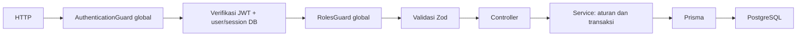
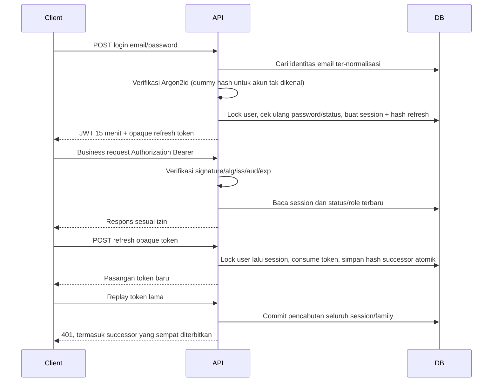
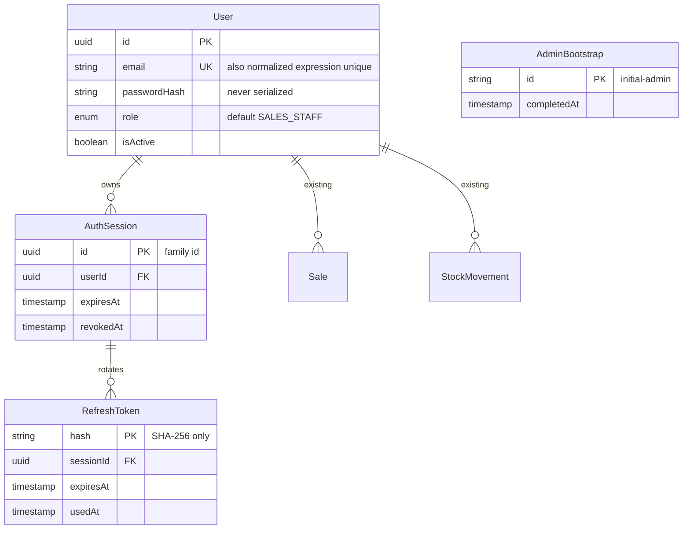

# Phase 3 — autentikasi, pengguna dan RBAC

## Audit sebelum implementasi

Repository aktual memakai NestJS common/core 12.4.2, Prisma CLI/client/adapter 7.10.1, Zod 4.6.7, ESM dan Vitest 4.1.12. Phase 2 memiliki CatalogService dengan transaksi serializable, schema DTO strict, presenter uang string, dua controller katalog, guard development lokal, health Terminus, dan dua migrasi. User sudah mempunyai id UUID, email unique case-sensitive, name, passwordHash, isActive, timestamps serta relasi Sale/StockMovement. Tidak ada role atau session. Tidak menganggap tujuh model database berarti workflow penjualan/inventory sudah berjalan.

Konvensi dipertahankan: controller menangani HTTP, service aturan bisnis, Prisma persistence layer, explicit @Inject, import relatif .js, Zod + StandardSchemaValidationPipe, Vitest. Perilaku bisnis katalog tetap sama; pengecualian yang disengaja adalah akses anonim/development diganti autentikasi/RBAC. Tes bisnis katalog tetap dijalankan dengan Admin yang login nyata. Sembilan tes guard lokal yang sudah tidak dipakai diganti tes RolesGuard dan pengujian akses tanpa token.

## Matriks izin implementasi

| Endpoint/aksi                        | Public                                         | ADMIN                         | SALES_STAFF     | WAREHOUSE_STAFF |
| ------------------------------------ | ---------------------------------------------- | ----------------------------- | --------------- | --------------- |
| GET health                           | Ya                                             | Ya                            | Ya              | Ya              |
| POST auth/login                      | Ya, dibatasi rate                              | Ya                            | Ya              | Ya              |
| POST auth/refresh                    | Memerlukan opaque refresh token, dibatasi rate | Ya                            | Ya              | Ya              |
| POST auth/logout                     | Tidak                                          | Session sendiri               | Session sendiri | Session sendiri |
| GET auth/me dan users/me             | Tidak                                          | Diri sendiri                  | Diri sendiri    | Diri sendiri    |
| GET users dan users/:id              | Tidak                                          | Ya                            | Tidak           | Tidak           |
| POST users                           | Tidak                                          | Ya                            | Tidak           | Tidak           |
| PATCH users/:id, /status, /role      | Tidak                                          | Ya, dengan aturan keselamatan | Tidak           | Tidak           |
| GET categories/products dan detail   | Tidak                                          | Ya                            | Ya              | Ya              |
| POST categories/products             | Tidak                                          | Ya                            | Tidak           | Ya              |
| PATCH categories/products/:id        | Tidak                                          | Ya                            | Tidak           | Ya              |
| POST categories/products/:id/archive | Tidak                                          | Ya                            | Tidak           | Tidak           |

Tidak ada self-registration. Tidak ada bypass menggunakan X-Role atau field permissions. Read katalog mempertahankan kontrak data Phase 2 termasuk costPrice; pembatasan read-only berarti tidak boleh menulis, bukan menyembunyikan field harga. Hash password dan seluruh tabel session/token tidak pernah diserialisasikan ke User API. Swagger UI/JSON merupakan middleware dokumentasi, bukan endpoint bisnis; saat ini dapat dibaca lokal tanpa token. Pengamanan publikasi dokumentasi menjadi keputusan deployment kelak.

## Alur request dan mentoring

Walaupun sering disebut Controller → Guard → Service → Prisma, guard sebenarnya berjalan **sebelum handler controller**. Authentication menjawab siapa pemanggilnya; authorization menentukan boleh tidaknya aksi. Token hilang/rusak/expired/session revoked/user nonaktif menghasilkan 401. User terautentikasi tanpa role yang dibutuhkan mendapat 403. Data invalid 400, record tidak ada 404, konflik unique/aturan Admin 409, rate limit 429.

AuthenticationModule dari @nestjs/authentication mendaftarkan guard global yang menutup route secara default. Hanya health, login, refresh yang @Public(). JwtAuthProvider extends JwtBearerProvider, memverifikasi HS256/type at+jwt/issuer/audience/expiry lalu menautkan sub + sid ke user aktif dan session belum expired/revoked. Role dibaca dari database setiap request; tidak disimpan dalam JWT sebagai otoritas. Respons me memakai presenter allowlist sehingga sid internal tidak bocor.

RbacModule diimpor setelah AuthenticationModule untuk memastikan RolesGuard berjalan setelah identitas terpasang. @Roles pada metode menggantikan aturan class; UsersController Admin secara default, /users/me secara eksplisit mengizinkan ketiga role. Endpoint baru tanpa @Roles tetap wajib autentikasi. Jika membutuhkan pembatasan tambahan, deklarasikan role pada class/metode. Service manajemen user memeriksa ulang Admin dalam transaksi untuk menghadapi actor yang dinonaktifkan/didemote saat request sedang berjalan.

## Lifecycle token

Access token default 900 detik (batas startup 60–900), HS256 dengan secret acak 32 byte dari 64 digit hex. Verifier allowlist HS256 dan type at+jwt; memeriksa issuer, audience dan exp. Sid bukan secret; hanya referensi server-side session. Pengaturan signing/verifying berasal dari fungsi jwtOptions yang sama. Tidak menulis JWT sendiri dengan crypto manual pada aplikasi.

Refresh token memakai randomBytes(32), base64url 43 karakter. Database hanya SHA-256 digest; hash cepat tepat untuk secret acak 256 bit, sementara password manusia harus hash lambat. Satu AuthSession adalah satu family/login/device. Default token refresh berlaku 7 hari, absolute session 30 hari; rotasi memperpanjang token sampai batas absolute session, tidak selamanya. Hash token yang sudah terpakai dipertahankan sampai family habis agar replay tetap terdeteksi.

Refresh memakai transaksi PostgreSQL READ COMMITTED dengan row lock eksplisit. Lock user lalu session menjaga urutan konsisten dengan perubahan user. Pemeriksaan token lama, usedAt dan insert successor berada dalam transaksi yang sama. Token yang sudah used mencabut revokedAt session; service mengembalikan sentinel dari transaksi lalu baru melempar 401, sehingga pencabutan tidak rollback. Sejalan dengan prinsip [refresh token rotation/replay detection RFC 9700 §4.14.2](https://www.rfc-editor.org/rfc/rfc9700.html#section-4.14.2), dua refresh bersamaan: satu dapat mengembalikan 200, yang lain 401; setelah keduanya selesai seluruh family dicabut. Klien wajib single-flight refresh; tidak ada grace window yang dapat menyamarkan replay.

Logout membutuhkan access token valid dan mencabut session dari identitas terverifikasi, tanpa menerima userId/sessionId dari body. Access token session tersebut langsung ditolak karena setiap request memeriksa DB. Logout tidak mencabut device/session lain. Logout berulang dengan bearer yang sudah dicabut menghasilkan 401; state pencabutan tetap idempotent. Jika access token habis, refresh dahulu lalu logout; bila refresh 401, hapus state lokal. Request bisnis yang sudah lolos guard sebelum pencabutan dapat selesai; ini bukan pembatalan retroaktif request yang sedang berlangsung.

## Password dan pencegahan kebocoran

Argon2id melalui argon2 0.45.2, memoryCost 19456 KiB (19 MiB), timeCost 2, parallelism 1, random salt, hashLength 32. Parameter tersebut mengikuti [baseline OWASP](https://cheatsheetseries.owasp.org/cheatsheets/Password_Storage_Cheat_Sheet.html#argon2id); ukur kapasitas sebelum menaikkan cost. Password provisioning 12–128 karakter, maksimal 256 UTF-8 byte, tidak blank. Tidak trim password, tidak memaksa pola komposisi arbitrer. Login menerima legacy password pendek dengan batas ukuran yang sama; hash legacy non-Argon2id tidak diterima dan harus diubah Admin, bukan dianggap plaintext atau di-rehash tanpa mengetahui password.

User tak dikenal/hash malformed menjalankan dummy Argon2id check. Password salah, akun tidak ditemukan dan akun nonaktif mengembalikan message identik `Invalid email or password`. Ini mengurangi enumerasi respons dan selisih biaya hashing; bukan klaim timing seluruh jaringan identik.

Tidak ada logging body/token/password di aplikasi. Observe dipertahankan dengan http.capture=false, redaction key eksplisit, serta pengecualian instrumentation provider identity/password/Prisma. Error filter global menormalkan error tanpa mengirim query atau credential ke klien; bentuk health Terminus tetap dipertahankan. Seluruh respons, termasuk kegagalan autentikasi/rate limit, diberi Cache-Control: no-store dan Pragma: no-cache. Ekspor telemetry nyata belum diuji dengan secret sungguhan; jangan mengaktifkan body capture atau logging Authorization di proxy/APM tambahan.

## Perubahan schema dan migrasi aman

Migrasi baru 20261110060000_identity_sessions:

- User.role enum ADMIN/SALES_STAFF/WAREHOUSE_STAFF, default SALES_STAFF. Tidak ada Admin otomatis dari user lama.
- Unique expression index lower(btrim(email)). Preflight menolak benturan sebelum DDL. Email lama tidak ditulis ulang; index juga melindungi penulisan langsung di luar API.
- AuthSession: id, userId, createdAt, expiresAt, revokedAt; FK RESTRICT ke User, index userId/expiry.
- RefreshToken: hash, sessionId, createdAt, expiresAt, usedAt; FK RESTRICT ke session, index sessionId, CHECK expiry.
- AdminBootstrap: penanda initial-admin yang dibuat bersama Admin dalam satu transaksi.

Email input baru dibatasi ASCII valid, trim dan lowercase; tidak menghapus plus-addressing/dot atau menerapkan aturan spesifik Gmail. Ini kebijakan identitas case-insensitive perusahaan, bukan klaim semua mailbox di internet case-insensitive. Lookup lower(btrim(email)) mengikuti index sehingga legacy uppercase/spasi masih ditemukan. Benturan legacy wajib ditinjau manual dan bukan diselesaikan reset/merge otomatis. Index expression dan CHECK manual tidak direpresentasikan Prisma DSL; pertahankan SQL pada migrasi berikutnya.

PrismaService sekarang menghormati parameter schema dari DATABASE_URL pada adapter dan search_path query SQL. Schema name dibatasi identifier sederhana. Ini memungkinkan isolated integration schema tanpa mengarahkan raw SQL ke public secara tidak sengaja. Aplikasi normal tetap memakai public.

## Manajemen user dan keselamatan Admin

PATCH users/:id hanya menerima name/email/password; role dan status memiliki endpoint terpisah. Create default SALES_STAFF; hanya Admin dapat memilih role lain. Password dihash server. Tidak ada API hard delete User sehingga relasi Sale/StockMovement dipertahankan. Password/email/role/status yang berubah mencabut seluruh session akun; reaktivasi tidak menghidupkan token lama.

Seluruh write manajemen Admin dan bootstrap memperoleh pg_advisory_xact_lock(71003001). Lock berlaku lintas proses API yang memakai database sama, dilepas otomatis saat commit/rollback. Sesudah memperoleh lock, service mengecek ulang actor Admin aktif. Menghapus akses Admin aktif terakhir ditolak 409; self-demotion dan self-deactivation juga ditolak walaupun ada Admin lain (kebijakan lebih ketat untuk mencegah lockout pribadi). Dua Admin yang bersamaan saling menonaktifkan tidak dapat meninggalkan nol Admin aktif. Advisory lock hanya efektif jika seluruh jalur write mengikuti service ini; perubahan SQL DBA di luar aplikasi tetap merupakan tanggung jawab operasional.

Bootstrap membaca JSON stdin, bukan argv. Tidak menerima field role dari input, tidak mempunyai password default. Penanda dan akun dibuat atomik; eksekusi ulang tidak mengganti password, mengaktifkan kembali user, atau mempromosikan non-Admin yang emailnya bertabrakan. Jika Admin sudah ada (bahkan nonaktif), command hanya mencatat bootstrap selesai tanpa mengganti akun. Marker tetap ada meskipun semua Admin kemudian hilang/nonaktif: pemulihan darurat membutuhkan prosedur DBA terkontrol, bukan mengulang bootstrap untuk memperoleh hak akses.

## Pilihan dependensi dan tradeoff

Dokumentasi first-party diperiksa sebelum instalasi: @nestjs/authentication menyediakan guard default-protected, decorators, provider JWT dan signer/verifier. PasswordHasher bawaannya memakai scrypt; kebutuhan eksplisit Argon2id dipenuhi dengan argon2. TokenService bawaannya tidak dipakai untuk refresh karena implementasi aplikasi menghendaki transaksi consume + successor + revocation dan pemeriksaan session langsung; opsi refreshToken:false mematikan mekanisme bawaan sehingga tidak ada fallback refresh in-memory. Tidak menambahkan JWT/Passport library lain.

@nestjs/authorization telah dievaluasi. Policy/ability tingkat resource belum diperlukan untuk tiga role statis; RolesGuard + @Roles cukup dan lebih mudah dipahami. @nestjs/throttler dipakai untuk membatasi login default 5 request/menit per socket peer (sukses/gagal), refresh 30/menit. Header X-Forwarded-For tidak dipercaya. Hit limiter hanya in-memory per proses dan reset ketika restart. Untuk multi-instance atau reverse proxy/BFF, strategi rate limit lintas instance/trusted proxy perlu dirancang sebelum deployment; tidak menambah Redis pada fase ini.

JWT + query session setiap request mengorbankan sebagian sifat stateless untuk pencabutan segera dan role selalu mutakhir. Ini pilihan sengaja untuk ERP dan modular monolith. Single shared secret HS256 cocok satu API; rotasi key/asymmetric signing/JWKS perlu desain jika pemverifikasi bertambah.

## Rekomendasi Next.js mendatang

API sekarang mengembalikan token JSON untuk Postman/CLI; belum mengeluarkan cookie dan CORS credentials tetap false. Frontend belum dibuat. Untuk browser, utamakan Next.js sebagai BFF: simpan token di server-side session dan beri browser cookie opaque HttpOnly + Secure + SameSite, bukan mengekspos refresh token ke JavaScript. Jangan menyimpan token pada localStorage, URL, analytics, log, React props/RSC payload, atau cache bersama. Secret signing tetap backend.

Jika kelak cookie refresh diterbitkan langsung API, desain CSRF (trusted origin, Origin check dan token CSRF), Secure/HttpOnly/SameSite serta path dan CORS credentials secara eksplisit. HttpOnly mengurangi pencurian token lewat JS tetapi tidak menghentikan XSS mengirim aksi atau menggantikan CSRF protection. Access token browser bila diperlukan hanya di memory, hilang saat reload; refresh harus single-flight lintas tab atau dikelola BFF. Hindari beberapa request refresh memakai token yang sama karena kebijakan replay mencabut family. HTTPS wajib pada deployment; HTTP loopback sekarang hanya development.

## Batas Phase 3

Belum ada MFA, reset/lupa password, email verification, breach-password screening, self-service password change, UI, daftar/revoke semua device oleh user, audit log persisten, atau pekerjaan pembersihan session terjadwal. Admin dapat mengganti password melalui endpoint management. Session/token yang habis perlu maintenance berkala: hapus hash token milik session expired, lalu session expired dalam transaksi, setelah batas family berakhir. Jangan menghapus used token sebelum absolute expiry karena replay detection membutuhkannya.

CRM/Inventory/Sales/Dashboard tetap tidak diimplementasikan. Tidak ada deploy atau push. Hasil aktual dan file manifest: PHASE3-VERIFICATION.md. Panduan operasional/manual/Postman: phase3-postman-guide.md.

Referensi yang diperiksa: [Authentication](https://docs.nestjs.com/security/authentication.md), [Authorization](https://docs.nestjs.com/security/authorization.md), [Rate limiting](https://docs.nestjs.com/security/rate-limiting.md). API yang digunakan juga diperiksa terhadap package terpasang, bukan hanya dokumentasi terbaru.
