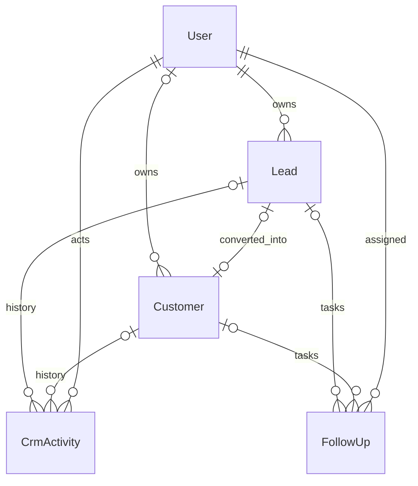

# Phase 4 — CRM Krivent

Phase 4 menggantikan bagian CRM rencana di business-requirements.md. Backend saja; tidak membuat Sale, fulfillment, notifikasi, Redis, job, atau frontend.

## Alur bisnis dan keputusan

Sales mencatat perusahaan dan contact person, melakukan kontak, memverifikasi kebutuhan, mengirim proposal, lalu menandai WON atau LOST. Konversi WON menghasilkan Customer. WON menyatakan keberhasilan negosiasi, bukan pembayaran atau order terpenuhi.

| Dari | Aksi tahap yang diizinkan |
| --- | --- |
| NEW | CONTACTED, LOST |
| CONTACTED | QUALIFIED, LOST |
| QUALIFIED | PROPOSAL, LOST |
| PROPOSAL | WON, LOST |
| WON / LOST | Tidak ada |

Tidak boleh skip, mundur, mengulang tahap, atau reopen. LOST wajib reason nonkosong. Transisi menghasilkan activity NOTE dari server; sales sebaiknya merekam interaksi nyata secara terpisah. Syarat kualifikasi diperiksa manusia; API tidak menganggap perpindahan tahap sebagai bukti verifikasi bisnis otomatis. Lead terminal dan lead terkonversi tidak dapat diedit. Arsip boleh dilakukan owner/admin, idempotent; tidak ada delete/restore. Arsip menyembunyikan data, bukan menghapus atau menutup otomatis task tertunda.

## ERD aditif

Activity/FollowUp wajib tepat satu parent (lead XOR customer), ditegakkan oleh Zod dan SQL CHECK. Semua foreign key Restrict menjaga histori. Indeks history `(leadId/customerId, occurredAt, id)`, task `(assigneeId,status,dueAt)`, dan lead `(ownerId,isActive,stage)` mendukung query utama. Stage/status memakai PostgreSQL enum. CHECK tambahan mewajibkan lost_reason saat LOST; graph transisi ditegakkan service transaksi.

Customer mempertahankan id, code, name, email, phone, address, timestamps dan relasi Sale lama. Kolom ownerId, leadId, contactName, dedupKey, normalizedEmail nullable; isActive default true. Data lama tanpa owner hanya dapat dikelola Admin. Tidak ada backfill otomatis. SQL menambahkan index unik nullable sehingga duplicate lama tidak menggagalkan migrasi. Risiko operasional: lock ALTER TABLE/index pada tabel Customer; terapkan migrasi pada waktu sesuai ukuran database. Hanya database development lokal yang dimigrasikan pada pekerjaan ini.

## Kebijakan akses

| Operasi | ADMIN | SALES_STAFF | WAREHOUSE / anonymous |
| --- | --- | --- | --- |
| Lead/customer aktif | Semua | Owner saja | 403 / 401 |
| Membuat lead/customer | Wajib menentukan owner sales aktif | Default diri sendiri | Ditolak |
| Menetapkan owner | Sales aktif mana pun | Diri sendiri; dilarang pindah ke user lain | Ditolak |
| Activity read/write | Semua parent aktif | Parent miliknya | Ditolak |
| Follow-up read/write/status | Semua parent aktif | Parent miliknya; penyelesaian juga memerlukan assignee dirinya | Ditolak |
| Query arsip/all | Ya, eksplisit | 403 | Ditolak |

Object-level scope ada di service/query, bukan hanya Roles guard. Objek milik sales lain dan referensi hilang sama-sama 404. Filter owner/assignee sales lain menghasilkan 403. Detail aktif default 404 untuk arsip; Admin dapat `?status=all`. Query history arsip juga eksplisit oleh Admin. History tidak pernah dihapus; tidak tersedia endpoint edit/delete activity.

Follow-up assignee harus sama dengan owner parent dan merupakan sales aktif. Ini menjaga keselarasan hak baca serta tanggung jawab. Reassignment parent oleh Admin memindahkan task PENDING secara atomik; task terminal mempertahankan assignee historis. Owner baru membaca seluruh histori parent, owner lama kehilangan akses. Owner Customer dapat berbeda dari owner lead asal setelah reassignment; masing-masing history mengikuti scope parent sendiri. Admin dapat menelusuri keduanya. Lead terminal immutable; penugasan customer setelah konversi dilakukan lewat Customer.

## Konversi, deduplikasi, konkurensi

`POST leads/:id/convert` hanya untuk WON aktif. Transaksi serializable memeriksa scope dan customer terkait, membuat Customer dan NOTE konversi bersama-sama. Unique `customers.lead_id` menjamin satu customer per lead. Pengulangan normal maupun paralel mengembalikan customer yang sama (200). Jika customer sudah diarsipkan, konversi berulang tetap mengembalikan hasil asli kepada owner/admin sebagai hasil aksi idempotent; ini tidak mengaktifkannya kembali. Jika ownership customer telah dipindah, sales lama mendapat 404 pada pengulangan, tanpa data customer.

Customer baru: code `C-` + 28 hex acak; dedupKey = nama perusahaan trim, collapse whitespace, lowercase; email trim/lowercase. Nama normalisasi ATAU email normalisasi sama dianggap benturan global, termasuk customer arsip. Tidak memakai nomor telepon sebagai unique karena kantor dapat berbagi nomor. Tidak menggabungkan otomatis customer lintas owner: 409 generik, tanpa nama/id pemilik lain. Kebijakan konservatif ini dapat menolak cabang perusahaan bernama sama; Admin perlu menyelesaikan identitas bisnis, bukan melewati constraint.

Unique dedupKey dan normalizedEmail melindungi penulisan baru. Data customer lama tetap utuh; service memeriksa nama/email lama saat create/update/convert di dalam transaksi. Konsekuensi: scan identitas customer O(n), dan duplicate legacy dapat menghalangi update. Audit dan backfill terpisah diperlukan sebelum memperbesar skala atau membuka jalur penulisan customer lain. Semua penulisan CRM harus melalui service; unique nullable tidak menjamin deduplikasi legacy dari raw SQL. Service mencoba ulang maksimal tiga kali setelah konflik serialisasi/keunikan; konflik tersisa 409 melalui error filter. Tidak ada Sale dibuat.

Activity/task lead tidak dipindah saat konversi, agar urutan histori tetap bermakna. Gunakan Customer.leadId untuk mengambil history asal sesuai izin; histori customer baru terpisah.

## Kontrak API

Prefix `/api/v1`; Bearer access token Phase 3 wajib. Body Zod strict menolak field tidak dikenal, termasuk actorId/role. actor activity diambil dari CurrentUser. Identitas user tidak pernah di-expand pada respons; tidak ada password/session. Customer presenter menghilangkan dedupKey dan normalizedEmail.

| Method | Path | Status sukses |
| --- | --- | --- |
| POST / GET | /leads | 201 / 200 |
| GET / PATCH | /leads/:id | 200 |
| POST | /leads/:id/archive | 200 |
| POST | /leads/:id/stage | 200 |
| POST | /leads/:id/convert | 200, termasuk pertama kali |
| POST / GET | /customers | 201 / 200 |
| GET / PATCH | /customers/:id | 200 |
| POST | /customers/:id/archive | 200 |
| POST / GET | /activities | 201 / 200 |
| POST / GET | /follow-ups | 201 / 200 |
| PATCH | /follow-ups/:id/status | 200 |

Objek tunggal: `{ "data": {...} }`. List: `{ "data": [], "meta": { "page":1,"pageSize":20,"total":0,"totalPages":0 } }`. Pagination 1-based, page maksimal 100000, pageSize 1–100. List dan count berbagi snapshot RepeatableRead; sort sekunder id memberi urutan stabil untuk nilai sama. Offset pagination tidak menjamin snapshot antar-request ketika data berubah.

Semua list: `status=active|archived|all` default active, `page`, `pageSize`, `sortBy`, `direction=asc|desc` default desc. Default sort createdAt. Filter khusus:

| Resource | Filter | Sort tambahan |
| --- | --- | --- |
| leads | search company/contact/email/phone case-insensitive, stage, ownerId, source exact | updatedAt, companyName |
| customers | search name/contact/email/code case-insensitive, ownerId | updatedAt, name |
| activities | search note, ownerId, leadId, customerId | occurredAt |
| follow-ups | ownerId, leadId, customerId, assigneeId, taskStatus, timing | updatedAt, dueAt |

Filter tidak relevan ditolak 400. `timing=overdue` berarti PENDING dueAt < waktu server; upcoming berarti PENDING dueAt >= waktu server (tanpa batas hari). Kombinasi timing dengan taskStatus terminal ditolak 400. Status task memakai `taskStatus` karena `status` dipakai visibilitas arsip parent. Timestamp ISO 8601 wajib timezone, disimpan timestamptz(3). Due date masa lalu diperbolehkan untuk pencatatan tugas terlambat. Follow-up PENDING -> COMPLETED/CANCELLED saja; mengulang aksi terminal 409. Tidak ada scheduler.

Error mengikuti `{statusCode,message}`: 400 validasi/referensi owner tak sesuai, 401 token tidak ada/tidak valid, 403 role/filter/reassignment ditolak, 404 objek tidak tersedia pada scope, 409 konflik lifecycle/duplicate/konkurensi. Detail dengan `status=all` tersedia hanya bagi Admin; status pada detail mengontrol inklusi arsip, bukan memfilter hanya arsip.

## Alur controller → guard → service → Prisma

Nest menerima route; guard autentikasi global memverifikasi JWT/session aktif dan RolesGuard memeriksa role. Pipe memvalidasi parameter/body Zod. Controller mengambil CurrentUser dari server dan meneruskan input ke service. Service menyusun scope owner, memeriksa state dan referensi, lalu menjalankan Prisma transaction. PostgreSQL menegakkan FK, unique, enum dan CHECK; error filter memetakan konflik tanpa menampilkan detail database. Controller membungkus data dan menyaring field internal sebelum JSON dikirim.

Untuk interview: guard menjawab “bolehkah role ini memakai fitur?”, service menjawab “bolehkah user ini mengakses baris ini?”, transaksi menjaga beberapa perubahan berhasil/gagal bersama, dan constraint melindungi invariant ketika request datang bersamaan. Read-then-create saja tidak cukup untuk konversi; tanpa unique dan transaksi dua request dapat menghasilkan dua customer.
