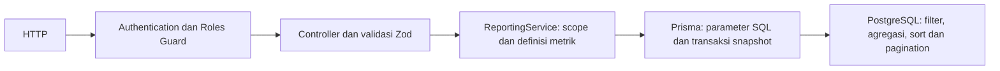

# Phase 7 — Dashboard, Business Reporting dan Audit

Backend modular monolith PostgreSQL; tidak memakai cache, queue atau BI eksternal. Modul baru `ReportingModule` membaca sumber kebenaran Sale/SaleItem, Customer/Lead, Product/StockMovement. Helper audit dipanggil modul bisnis di dalam transaksi yang sudah ada. API baru read-only dan berada di `/api/v1`; kontrak interaktif di `/api/docs`, dokumen JSON di `/api/docs-json`.

## Alur dan alasan arsitektur

Secara konseptual Controller menerima permintaan, Guard memastikan siapa pemanggil dan izin role, Service menentukan data yang boleh terlihat, Prisma mengirim query, dan PostgreSQL menghitung hasilnya. Pada runtime Nest, Guard berjalan sebelum parameter controller divalidasi. Controller tipis tidak menghitung uang. Guard saja tidak cukup: sales yang sah tetap tidak boleh melihat pelanggan sales lain. Karena itu ownership masuk ke WHERE sebelum COUNT/SUM/GROUP BY, bukan disaring setelah semua data diambil.

Agregasi berarti merangkum banyak baris, misalnya `SUM(total_amount)` per hari. PostgreSQL mengerjakannya dekat data; aplikasi hanya menerima halaman hasil. `Sale` dihitung tanpa JOIN item untuk menghindari satu order dihitung sebanyak jumlah produknya. Ranking produk memakai `SaleItem.quantity * unitPrice`, yaitu snapshot harga saat order dibuat. Perubahan harga katalog tidak mengubah nilai historis.

Prisma tagged SQL mengikat nilai sebagai parameter; identifier, arah urut dan enum ranking berasal dari pilihan konstan server. Tidak ada SQL hasil concatenation input. DTO memakai strict Zod dengan StandardSchemaValidationPipe yang sudah terpasang. Tidak menambah library.

## Definisi metrik

| Metrik | Rumus dan batas |
| --- | --- |
| Active customers | COUNT Customer isActive=true; sales dibatasi ownerId saat ini |
| Active leads | Lead isActive=true dan stage bukan WON/LOST |
| Pipeline | Jumlah Lead aktif per stage, termasuk WON/LOST; bukan estimasi nilai uang |
| Orders by status | COUNT Sale dan SUM totalAmount per status; filter waktu pada createdAt |
| Ordered value | Total snapshot order per status, termasuk DRAFT/CONFIRMED/CANCELLED; bukan pendapatan |
| Realized sales | SUM Sale.totalAmount dengan status FULFILLED atau COMPLETED dan fulfilledAt tidak null; rentang pada fulfilledAt |
| Realized order count | COUNT order yang sama; COMPLETED tidak menambah kejadian kedua |
| Low stock | Product aktif dengan stockQuantity <= lowStockThreshold, termasuk saldo nol |
| Recent activity | Maksimal 10 CRM activity terbaru, proyeksi id/target/type/occurredAt; scope pada owner target saat ini |
| Recent inventory events | Maksimal 10 ledger event terbaru, proyeksi operasional tanpa harga/customer |

Dashboard `/dashboard/summary` mengembalikan `{data:{...}}`. from/to hanya memengaruhi ordersByStatus dan realizedSales. Customer aktif, pipeline, saldo, dan recent events adalah keadaan saat ini; recent tidak mengikuti date range. Kelompok tanpa data berupa `[]`; count nol, realized total `"0.00"`. Tidak mengisi hari/stage/status kosong dengan baris buatan.

Realized sales di sini adalah nilai fulfillment operasional, bukan kas diterima, pengakuan akuntansi atau laba. Tidak ada pembayaran, pajak, diskon, retur, atau multi-currency pada model sekarang. Order DRAFT, CONFIRMED, CANCELLED dikecualikan. Order lama COMPLETED tanpa fulfilledAt tidak memiliki bukti waktu realisasi, sehingga dikecualikan dan tidak diisi timestamp buatan. Rekonsiliasi legacy memerlukan bukti bisnis di pekerjaan terpisah.

## Laporan dan kontrak

Semua daftar: `{data:[],meta:{page,pageSize,total,totalPages}}`. `page` 1–100000, `pageSize` 1–100, default 1/20. Halaman melebihi akhir menghasilkan data kosong dengan total tetap. Total adalah jumlah grup hasil, bukan jumlah source row. Sort tetap di server dan didokumentasikan, tidak menerima nama kolom bebas.

| Endpoint GET | Filter | Isi dan urutan stabil |
| --- | --- | --- |
| `/reports/sales` | from,to,page,pageSize | Realized sales dan orderCount per hari UTC; date DESC |
| `/reports/top-products` | di atas + rankBy=quantity/value (default quantity) | Kuantitas serta nilai snapshot item order terealisasi; metric DESC secara numerik lalu productId ASC untuk tie |
| `/reports/sales-performance` | tanggal/pagination + staffId | OrderCount dan realizedSales diatribusikan ke Sale.createdById; nilai DESC lalu staffId ASC |
| `/reports/lead-conversion` | tanggal/pagination | Cohort Lead.createdAt dalam rentang, termasuk archived; jumlah per stage ASC menurut urutan enum NEW, CONTACTED, QUALIFIED, PROPOSAL, WON, LOST |
| `/reports/inventory?view=balances` | page,pageSize,productId,lowStock=true/false | Saldo produk aktif sekarang; SKU ASC lalu productId ASC |
| `/reports/inventory?view=movements` | tanggal/pagination,productId,type | Ledger historis termasuk produk archived; createdAt DESC lalu id ASC |
| `/audit-logs` | tanggal/pagination,actorId,action,resourceType,resourceId | Audit tersimpan; createdAt DESC lalu id ASC |

Tidak ada field assigned Sales Staff pada Sale. Maka performance memakai **pembuat order** yang memang tersimpan, bukan mengarang assignment historis dari pemilik customer. Sales melihat atribusi dirinya sendiri dan hanya order customer yang masih dimilikinya; staffId orang lain menghasilkan 403. Admin dapat melihat semua pembuat, termasuk histori user yang kini berubah role/status. Customer ownership masih berlaku pada laporan sales/top-products, termasuk jika pembuat berbeda. Karena pembatasan tambahan ini, performance milik Sales bisa lebih kecil daripada total penjualan customer miliknya.

Conversion mengembalikan tambahan `summary:{leadCount,convertedCount,conversionRate}`. Converted berarti Lead mempunyai Customer.leadId, bukan sekadar stage WON. Untuk sales, customer hasil konversi juga harus masih dimilikinya. Rate = convertedCount / leadCount × 100, dibulatkan dua desimal dengan Decimal; cohort kosong `"0.00"`. Ini konversi cohort **as of now**, bukan jumlah event konversi yang terjadi pada rentang tersebut. Lead archived tetap bagian cohort; dashboard active leads berbeda definisi. Ownership/stage historis tidak direkonstruksi.

Inventory menambah `summary:{activeProducts,lowStockProducts,stockQuantity}` untuk produk aktif sekarang, hanya mengikuti productId. lowStock hanya menyaring daftar balances, bukan summary. Movement view menambah `movements:[{type,count,netQuantity}]` sesuai seluruh filter tanggal/type/product, di luar pagination. NetQuantity = SUM delta bertanda; bukan saldo historis. Saldo summary tetap saat ini, termasuk bila ada filter waktu ledger. Date/type pada balances dan lowStock pada movements ditolak 400 agar tidak ada filter yang diam-diam diabaikan.

Uang string tepat dua desimal IDR; PostgreSQL numeric menjumlahkan uang tanpa konversi Number. Kuantitas agregat/string integer (top products, summary stockQuantity, movement netQuantity) mencegah kehilangan presisi bigint di JavaScript. Kuantitas tiap baris saldo/movement tetap integer JSON. Tanggal keluar ISO 8601 dengan offset (SQL JSON dapat memakai `+00:00`, Prisma Date memakai `Z`).

## Waktu dan validasi

from/to opsional; tanpa batas berarti seluruh sejarah. Input wajib ISO datetime dengan `Z` atau offset eksplisit, maksimal presisi milidetik sesuai timestamptz(3). Tanggal invalid dan local datetime tanpa offset ditolak. Rentang setengah terbuka `[from,to)`: from termasuk, to tidak termasuk; harus from < to bila keduanya ada. Tidak menerima tanggal saja. Untuk Oktober WIB gunakan `from=2026-10-01T00:00:00+07:00&to=2026-11-01T00:00:00+07:00`; URL-encode tanda `+` atau gunakan Postman Params. Hari laporan sales selalu UTC, tidak otomatis WIB. Bucket pertama/terakhir dapat parsial jika batas bukan tengah malam UTC.

## RBAC

| Endpoint/data | ADMIN | SALES_STAFF | WAREHOUSE_STAFF | Anonymous |
| --- | --- | --- | --- | --- |
| Dashboard | Semua domain | Sales/CRM owner sendiri | Hanya inventory | 401 |
| Sales/top products | Company-wide | Current customer ownership | 403 | 401 |
| Sales performance | Company-wide | Own creator + current customer ownership | 403 | 401 |
| Lead conversion | Company-wide | Current lead/customer ownership | 403 | 401 |
| Inventory report | Ya | 403 | Ya | 401 |
| Audit logs | Ya | 403 | 403 | 401 |

Role terlarang 403, input invalid 400 dengan format filter error existing `{statusCode,message}`. Scope bukan parameter owner yang dipercaya dari klien. Customer null/owner null hanya masuk laporan company-wide Admin. Perpindahan ownership mengubah visibilitas seluruh histori. Metadata audit hanya melalui endpoint Admin; dashboard memakai activity/ledger terotorisasi, tidak membocorkan isi audit kepada role lain.

## Audit persisten dan konsistensi transaksi

AuditLog: UUID, actorId UUID, action, resourceType, resourceId UUID, createdAt database timestamptz(3), metadata JSON terpilih, requestId UUID opsional. Actor/resource adalah referensi historis tanpa FK agar identitas tetap tersimpan meski kebijakan penghapusan berubah. Tidak menyalin email, nama, passwordHash, token, header, request body, notes atau reason. Metadata hanya perubahan skalar yang diizinkan helper; object nested dibuang. Ini changed-field summary nilai akhir, bukan seluruh before/after record.

| Event | Resource | Metadata |
| --- | --- | --- |
| USER_ROLE_CHANGED / USER_STATUS_CHANGED | USER | role atau isActive |
| PRODUCT_PRICE_CHANGED | PRODUCT | costPrice, sellingPrice dalam string |
| PRODUCT_ARCHIVED | PRODUCT | isActive=false |
| LEAD_STAGE_CHANGED | LEAD | stage |
| LEAD_CONVERTED | LEAD | customerId |
| INVENTORY_RECEIVED / INVENTORY_ADJUSTED | STOCK_MOVEMENT | productId, quantity, beforeBalance, afterBalance |
| ORDER_CONFIRM / ORDER_COMPLETE / ORDER_CANCEL | SALE | status |
| ORDER_FULFILLED | SALE | status=FULFILLED |

No-op role/status atau archive tidak membuat event tambahan; idempotent conversion/receipt/fulfillment replay juga tidak. Create order, perubahan notes, login, password, CRUD kategori, dan stock SALE per item bukan event audit tersendiri pada fase ini. Fulfillment mempunyai satu event order; detail pemotongan per item tetap di immutable stock ledger. Event dibuat hanya untuk aksi sukses baru, tanpa backfill sejarah.

Transaksi adalah satu paket perubahan: semuanya commit atau semuanya rollback. Service memanggil `audit(tx, ...)` dengan transaction client **yang sama**. Jika stok item kedua kurang, deduction item pertama, ledger, status, receipt dan audit tidak boleh menyisakan sukses palsu. Sebaliknya jika audit gagal ditulis, perubahan bisnis turut gagal. Audit bukan fire-and-forget, interceptor setelah respons, atau panggilan Prisma di luar transaksi. Retry serializable CRM/katalog juga rollback event percobaan sebelumnya.

Request middleware membuat UUID server dan mengembalikan `X-Request-ID`; AsyncLocalStorage meneruskannya ke audit tanpa meneruskan request body/credential. Pemanggilan service internal/command tanpa HTTP boleh mempunyai requestId null dan harus memberi actorId nyata. Header klien tidak dipercaya sebagai ID. ReportingService ditambahkan ke pengecualian instrumentasi otomatis Observe seperti service sensitif existing; HTTP capture tetap false.

Tidak ada endpoint UPDATE/DELETE audit. Trigger PostgreSQL menolak UPDATE, DELETE dan TRUNCATE, termasuk lewat Prisma/raw SQL biasa. Trigger tidak menjamin anti-tamper terhadap owner/superuser yang dapat menonaktifkannya. Runtime produksi sebaiknya memakai role terbatas (SELECT/INSERT audit, tanpa DDL); konfigurasi/deployment role itu tidak dilakukan pada fase ini. Audit helper tidak melacak SQL langsung di luar jalur service. Backup berizin tetap diperlukan; audit bukan hash chain/arsip forensik eksternal.

Retention: tidak ada TTL/purge otomatis, simpan tanpa batas pada fase ini. Pertumbuhan, backup dan akses Admin perlu dipantau. Kebijakan retensi formal/arsip dan penghapusan khusus berizin harus dirancang sebelum mengubah data; operasi aplikasi biasa tetap immutable. Jangan menghapus audit untuk merapikan fixture bisnis produksi.

## Indeks dan performa

Indeks seperti daftar isi buku membantu PostgreSQL menemukan baris rentang waktu tanpa membaca semua baris. Migrasi aditif menambah `(status,fulfilled_at,id)` untuk realisasi dan `(created_by_id,fulfilled_at)` untuk performance. Indeks existing customer owner/isActive, sales customerId, sale_items saleId/productId, lead owner/stage dan createdAt, serta movement type/time/product tetap dipakai. Audit memiliki createdAt/id, resourceType/resourceId/createdAt, actorId/createdAt untuk histori terbaru dan pencarian objek/actor. Tidak menambah index action terpisah tanpa pengukuran; filter action bisa memindai histori dalam batas waktu.

Agregasi, count, sorting dan pagination dilakukan database; tidak ada N+1 atau pengambilan seluruh order/item ke memori aplikasi. Dashboard melakukan jumlah query tetap dan maksimal 10 recent per domain. Pagination menjumlahkan grup di DB; JSON aggregation memakai ORDER BY eksplisit. Semua query satu respons memakai transaksi RepeatableRead untuk snapshot konsisten. Snapshot antar-request berbeda, sehingga offset pagination masih dapat bergeser ketika data berubah. Batas pageSize tidak membatasi pekerjaan COUNT/SUM seluruh data; gunakan rentang tanggal sempit saat volume naik. Timeout query existing 3 detik dan transaksi reporting 10 detik tetap berlaku. Tidak mengklaim load test/EXPLAIN produksi; ukur sebelum optimasi lebih lanjut.

Low-stock membandingkan dua kolom sehingga indeks B-tree sederhana bukan solusi umum; masih scan kandidat produk aktif di PostgreSQL. Index sales status/fulfilledAt juga memiliki biaya write dan planner bisa memilih scan untuk rentang besar. Tidak ada materialized view/cache karena modul monolith dan volume belum terbukti memerlukannya.

## Migrasi, tes dan batas tersisa

`20261111100000_reporting_audit` hanya menambah tabel, lima indeks, function dan trigger imutabilitas. Tidak mengubah data/tabel bisnis existing, tidak mengisi histori buatan, tidak reset/db push. SQL ditinjau sebelum `npm run db:deploy`. Jalankan build sebelum integrasi bootstrap yang memakai dist.

Lihat [hasil aktual](../PHASE7-VERIFICATION.md) dan [Postman](phase7-postman-guide.md). Prisma drift memeriksa bagian DSL; function/trigger SQL perlu pengujian nyata (tersedia). Batas tersisa: legacy tanpa timestamp, atribusi creator bukan assigned staff, tidak ada snapshot ownership historis, offset bergeser, retensi belum formal, audit privileged-user bypass, count memakai PostgreSQL integer (batas sekitar 2,1 miliar per grup/count), dan biaya agregasi rentang sangat besar. Tidak mengimplementasikan frontend atau fase sesudah Phase 7.
